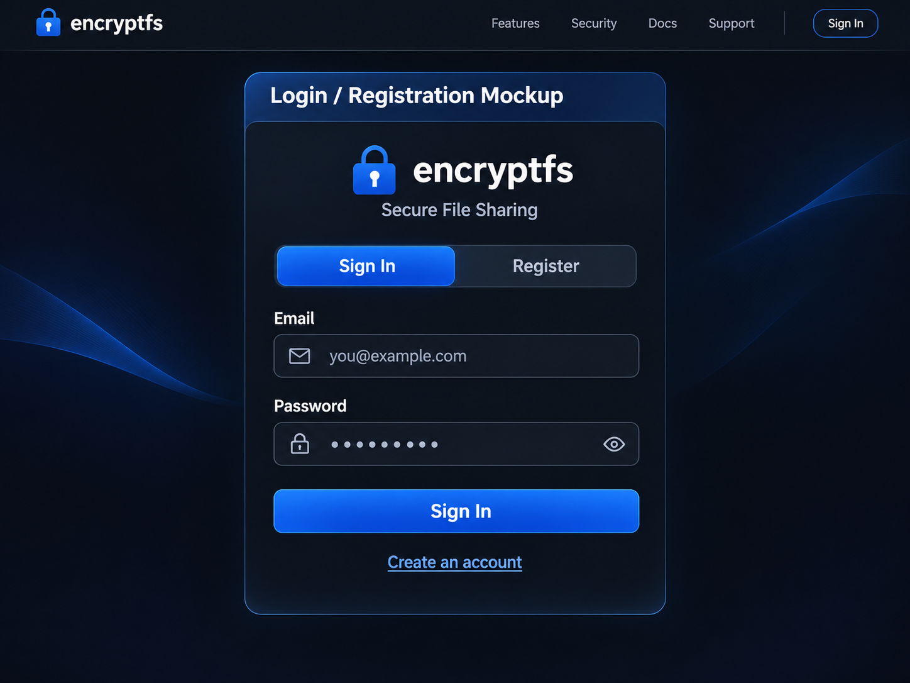
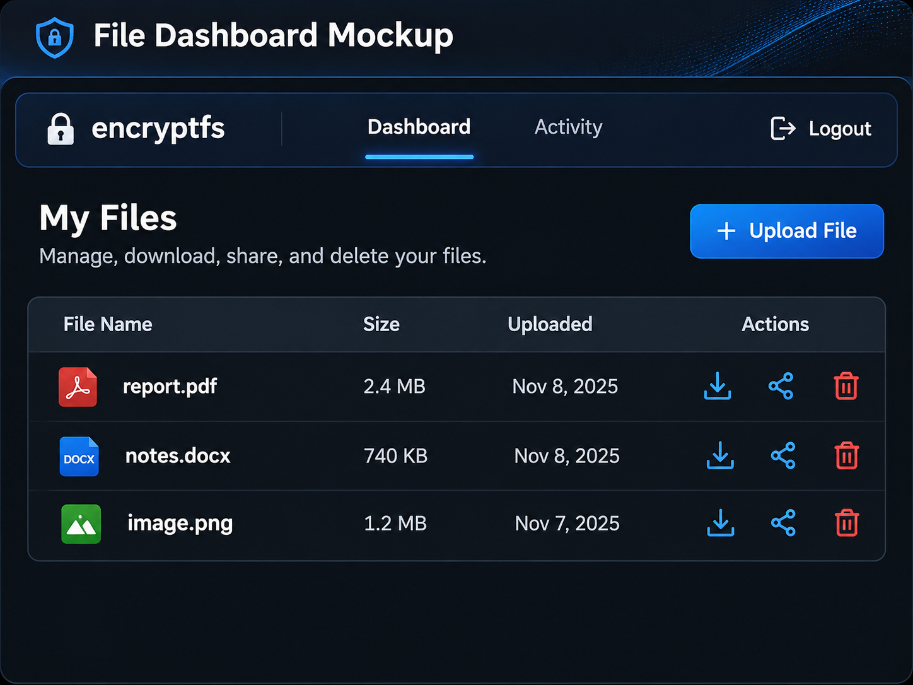
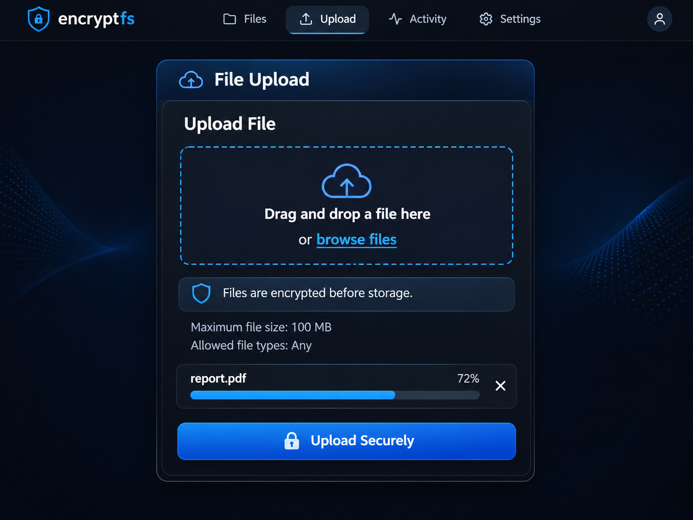
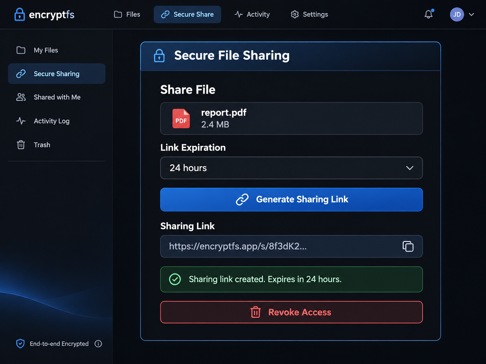

# encryptfs — Project Documentation

## 1. User Stories

The following user stories define the core functional requirements for encryptfs, a secure web-based file storage and sharing application. The platform is intended to provide users with a straightforward method of storing, accessing, and securely sharing sensitive files.

### US-01: User Registration

As a **new user**, I want to **create an account using my email address and password** so I can **securely access and manage my personal files**.

**Acceptance Criteria:**
- Users can register using a valid email address and password.
- The application rejects duplicate email addresses and invalid registration information.
- Passwords are securely hashed before being stored in the database.
- Successful registration creates a user account that can be used to authenticate.

### US-02: User Authentication

As a **registered user**, I want to **securely log in and log out of my account** so I can **access my stored files while preventing unauthorized access**.

**Acceptance Criteria:**
- Users can log in with valid credentials.
- Invalid login attempts are rejected with a generic error message.
- Authentication is required to access private file management features.
- Logging out invalidates the user's authenticated session.

### US-03: Secure File Upload

As an **authenticated user**, I want to **upload files to my personal storage** so I can **securely store important documents and access them when needed**.

**Acceptance Criteria:**
- Authenticated users can select and upload files through the application.
- The application enforces a configurable maximum file size.
- Files are encrypted before being written to persistent storage.
- Uploaded files are associated with the account of the user who uploaded them.
- The application confirms successful uploads and displays appropriate error messages when uploads fail.

### US-04: File Management Dashboard

As an **authenticated user**, I want to **view and manage my uploaded files in a centralized dashboard** so I can **easily organize and access my stored information**.

**Acceptance Criteria:**
- The dashboard displays the authenticated user's uploaded files.
- Each file displays relevant information, including its filename, file size, and upload date.
- Users can select files to download, share, or delete.
- Users cannot view or manage files belonging to other accounts.
- The application displays a helpful message when no files have been uploaded.

### US-05: Secure File Download

As an **authenticated file owner**, I want to **download my encrypted files** so I can **retrieve and use my information without compromising its confidentiality while stored**.

**Acceptance Criteria:**
- Users can request downloads of files they own.
- The application verifies file ownership before processing each download.
- Encrypted files are decrypted by the application only after authorization succeeds.
- Downloaded files retain their original contents and filename.
- Unauthorized file download requests are denied.

### US-06: Secure File Sharing

As an **authenticated file owner**, I want to **generate secure, time-limited file-sharing links** so I can **share documents with others without making them publicly accessible indefinitely**.

**Acceptance Criteria:**
- Users can generate a unique sharing link for a selected file.
- Sharing links use cryptographically secure, unpredictable tokens.
- Users can configure an expiration date or time for each link.
- Expired links no longer permit file downloads.
- Recipients can access shared files without gaining access to the owner's dashboard or other files.

### US-07: Share Revocation and Access Control

As a **file owner**, I want to **revoke access to previously shared files** so I can **prevent further downloads when sharing is no longer necessary**.

**Acceptance Criteria:**
- File owners can view active sharing links for their files.
- File owners can revoke an existing sharing link.
- Revoked links immediately stop granting access to files.
- Only authorized file owners can modify sharing settings.
- Revocation does not delete the original stored file.

### US-08: File Activity Monitoring

As a **file owner**, I want to **view access activity associated with my stored files** so I can **identify potentially unauthorized activity and understand how my files are being used**.

**Acceptance Criteria:**
- The application records important file events, including uploads, downloads, sharing, and revocations.
- File owners can view activity associated with their files.
- Activity entries include an event type and timestamp.
- Users cannot access another user's private activity history.
- Access history does not expose passwords, raw sharing tokens, or encryption keys.

---

## 2. Misuser Stories

The following misuser stories identify potential security threats to encryptfs and establish mitigation requirements that support the confidentiality, integrity, and availability of stored information.

### MU-01: Unauthorized File Access

As a **malicious authenticated user**, I want to **modify file identifiers in requests to access another user's stored documents** so I can **obtain confidential information without permission**.

**Mitigation Criteria:**
- Every private file request verifies ownership or an explicitly granted permission.
- Authorization is enforced server-side rather than relying on hidden interface elements.
- Unauthorized requests return an appropriate denial without exposing file contents.
- Unauthorized access attempts are recorded in security logs.

### MU-02: Brute-Force Authentication

As an **external attacker**, I want to **repeatedly guess user passwords** so I can **gain unauthorized access to user accounts and stored files**.

**Mitigation Criteria:**
- Login requests are subject to rate limiting.
- Passwords are stored using a secure, adaptive password-hashing algorithm.
- Authentication failures do not reveal whether a specific email address exists.
- Repeated failed authentication attempts are logged for security monitoring.

### MU-03: Malicious File Upload

As a **malicious authenticated user**, I want to **upload malicious or unauthorized file content** so I can **exploit the application or compromise other users**.

**Mitigation Criteria:**
- Uploads are restricted by a configurable file-size limit.
- Files are stored outside publicly executable directories.
- The application generates safe internal storage identifiers rather than trusting uploaded filenames as paths.
- Downloads use safe response headers to reduce unintended browser execution of uploaded content.
- File validation and optional malware scanning can be incorporated before allowing wider distribution.

### MU-04: Path Traversal

As a **malicious user**, I want to **manipulate file paths or filenames in requests** so I can **read sensitive server files or access data outside my authorized storage**.

**Mitigation Criteria:**
- File access uses server-generated identifiers rather than user-supplied filesystem paths.
- User-controlled filenames are never directly used to construct sensitive filesystem paths.
- The application restricts file operations to an approved storage location.
- Attempts to access invalid or unauthorized resources are rejected and logged.

### MU-05: SQL Injection

As an **external attacker**, I want to **submit malicious database input through application fields** so I can **extract, alter, or destroy confidential application data**.

**Mitigation Criteria:**
- Database operations use Django's ORM or parameterized queries.
- User input is never concatenated directly into SQL statements.
- Application forms validate input against expected types and constraints.
- Database error messages do not expose internal query details to users.

### MU-06: Cross-Site Scripting (XSS)

As a **malicious authenticated user**, I want to **inject harmful JavaScript through filenames or user-controlled content** so I can **execute unauthorized actions in another user's browser**.

**Mitigation Criteria:**
- User-controlled text is safely escaped when rendered in HTML.
- Templates do not mark untrusted input as safe.
- The application uses an appropriate Content Security Policy to limit unauthorized script execution.
- Uploaded HTML or other active content is not served as trusted same-origin application content.

### MU-07: Sharing Link Abuse

As an **unauthorized recipient**, I want to **guess, reuse, or manipulate file-sharing links** so I can **download documents after access expires or obtain files that were never shared with me**.

**Mitigation Criteria:**
- Sharing tokens are generated using a cryptographically secure random generator.
- Every download through a sharing link checks its expiration and revocation status.
- Tokens are not sequential or easily predictable.
- Sharing link requests are rate-limited to reduce automated guessing attempts.
- Revoked or expired links cannot be used to retrieve file contents.

### MU-08: Encryption Key Exposure

As an **attacker with access to application source code or stored files**, I want to **obtain encryption keys or decrypt stored documents** so I can **read confidential data without authorization**.

**Mitigation Criteria:**
- Stored files use authenticated encryption, such as AES-256-GCM.
- Encryption keys are never hardcoded in source code or committed to GitHub.
- Sensitive key material is stored separately from encrypted file contents and is not exposed to users.
- Unique nonces are generated for each encryption operation.
- Decryption operations reject files that fail authentication or integrity verification.

---

## 3. Interface Mockups

### 3.1 Login and Registration

### 3.2 File Dashboard

### 3.3 File Upload

### 3.4 Secure Sharing

## 4. C4 Architecture Diagrams

### 4.1 System Context Diagram

### 4.2 Container Diagram

### 4.3 Component Diagram

